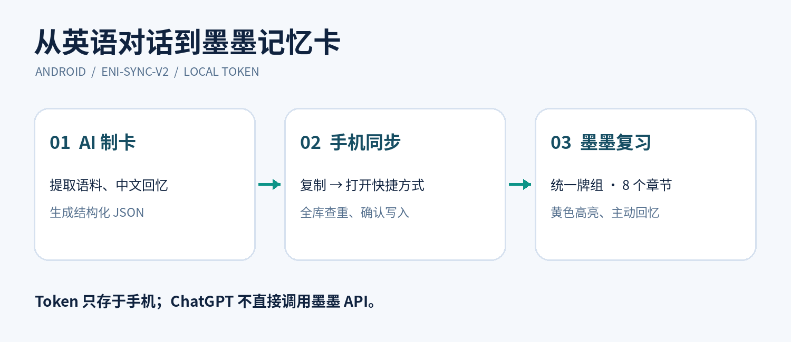

# ENI · 考研英语一 × 墨墨记忆卡

**让日常 AI 作文批改变成可以主动回忆、间隔复习的英语语料卡。**



`Android` · `ChatGPT Skill` · `Markji OpenAPI` · `ENI-sync-v2` · `GV3` · `MIT`

这是一个非官方的开源学习工作流，不需要服务器或电脑常驻。AI 负责提取语料、纠正表达和制卡；Android 上的 HTTP Request Shortcuts 在用户确认后，使用本地 Token 把卡片写入自己的墨墨记忆卡（Markji）私有牌组。

> **先读：[完整手机端图文教程](docs/guide.md)** ｜ [无需插件的 AI 提示词](examples/prompt.md) ｜ [安全与隐私](SECURITY.md) ｜ [更新日志](CHANGELOG.md)

## 为什么做这个项目？

考研英语写作真正难的是把认识的表达变成能独立写出的表达。把作文错句、优质句型和主题搭配制成中文 → 英文的主动回忆卡，可以减少反复整理语料的时间。采用一个英语牌组、八个章节，避免牌库越建越臃肿。

## 功能预览

<table><tr><td width="48%"></td><td valign="top"><strong>卡片设计</strong><br/>具体功能标题、紫色迁移主题、中文主动回忆提示、蓝色完整答案、黄色重点语法、绿色迁移例句。<br/><br/><strong>同步设计</strong><br/>用户确认后新增；按整个目标牌组的规范化英文答案查重；回读校验；不删除、不覆盖旧卡。<br/><br/>截图来自个人版实测，已裁掉个人标识。公共版不附带私人牌库。</td></tr></table>

## 快速开始

1. 安装 [HTTP Request Shortcuts](https://play.google.com/store/apps/details?id=ch.rmy.android.http_shortcuts)（也可从 [开源项目](https://github.com/Waboodoo/HTTP-Shortcuts) 获取）。准备墨墨记忆卡账号和自己的 API Token。
2. 在墨墨建立自建、私有牌组 `考研英语一·作文语料`，手动建立 [八个指定章节](examples/chapters.txt)，删除多余的空默认章节或将它改名为第一章。
3. 在 HTTP 快捷方式中建立全局静态变量 `markji_token`，仅填 Token 本身。建立脚本快捷方式，粘贴 [配置检查脚本](scripts/ENI-check.js)，运行通过后再建立 [同步脚本](scripts/ENI-sync.js)。
4. 复制 [单卡测试 JSON](examples/first-card.json) 的原始文本，打开 HTTP 快捷方式 App 主界面，运行同步并确认。再次复制同一 JSON 运行，应新增 0 张、跳过 1 张。
5. 把 [提示词](examples/prompt.md) 发给 ChatGPT，或在支持自建插件的账号使用 [插件源码](plugin/)。要求「收录本篇语料」，复制生成的完整 JSON 并同步。

**完整步骤及故障处理见 [图文教程](docs/guide.md)。**

## 仓库结构

```text
README.md                 GitHub 项目首页
plugin/                   ChatGPT/Codex 技能插件源码（可选）
scripts/ENI-check.js       只读自检
scripts/ENI-sync.js        日常新增、查重、回读
scripts/ENI-backup.js      本地只读备份（可选）
scripts/ENI-beautify.js    旧标准纯文本卡只读预览，显式开启后单张美化（可选）
examples/                 八章节、提示词及三类测试卡
docs/guide.md             完整图文安装及使用教程
docs/images/              工作流图与脱敏截图
tests/                    离线模拟测试
SECURITY.md               安全说明
LICENSE                   MIT 许可（项目代码和原创文档）
```

## 运行测试

电脑端仅开发者需要 Node.js 24+，无需 npm 依赖：

```sh
node --test tests/workflow.test.cjs
```

GitHub Actions 使用 Node.js 24 和当前稳定版 checkout/setup-node Action 自动运行这套离线测试。手机用户不需要 Node.js，也不要把脚本直接运行在浏览器控制台。脚本依赖 HTTP Request Shortcuts 提供的 JS 接口。

## 已验证与限制

- 个人版已真实验证：墨墨认证、手机新增卡片、八章节统一牌组、跨章新增、重复拦截、GV3 黄色高亮以及原地更新样卡。
- 此公开版已移除固定账号/牌组 ID、旧牌组迁移逻辑及最小卡片数量条件。离线测试不等于所有新账号及客户端版本的真实验收，首次请使用空的私有测试牌组。
- 当前是**用户确认的半自动同步**，不是后台监听聊天，也不是 ChatGPT 直接操作墨墨。只支持 Android 本地快捷方式；iOS 暂无对应实现。
- 只支持规定格式的纯文本卡；查重为标准答案规范化匹配，并不识别所有同义句或非标准卡。没有自动清理、跨牌组迁移或删除功能。
- 旧卡美化默认 `PREVIEW_ONLY=true`，只读展示修改前后内容，不调用写入接口；只有用户先备份、手动改为 `false` 并再次确认后才更新，每次默认最多一张。
- 插件安装能力取决于账号和工作空间权限；普通提示词方案不需要 Plugin Creator。GitHub 开源不等于上架 ChatGPT 公共插件目录。

## 参考与致谢

- [墨墨开放 API / GV3 制卡指南](https://open.maimemo.com/)
- [墨墨记忆卡网页端](https://markji.com/)
- [HTTP Request Shortcuts 开源项目](https://github.com/Waboodoo/HTTP-Shortcuts) / [脚本文档](https://http-shortcuts.rmy.ch/scripting)
- [ChatGPT 插件官方说明](https://help.openai.com/en/articles/20001256-plugins-in-chatgpt)

本项目由 S1LVER 发起。项目源码与原创文档使用 [MIT License](LICENSE)。不包含任何第三方 App 安装包或私人语料库。第三方商标、界面归其权利人所有。本项目与 OpenAI、墨墨及 HTTP Request Shortcuts 官方无隶属关系。
