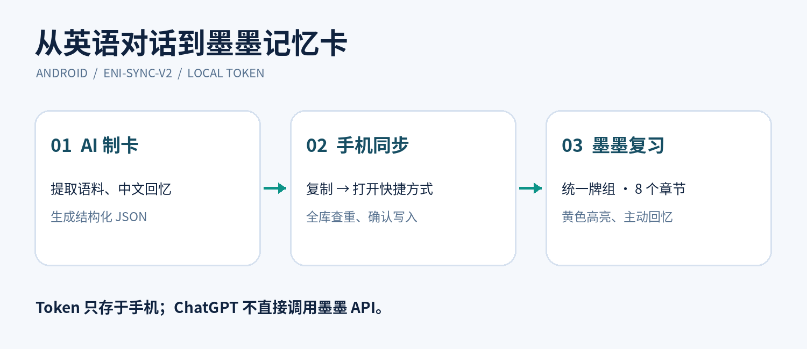
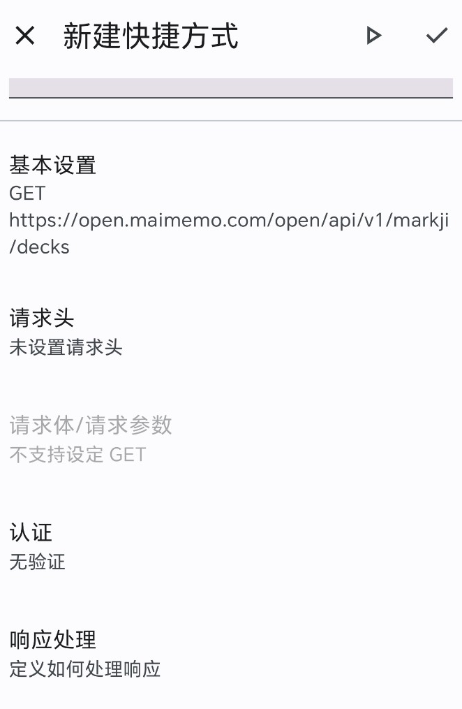
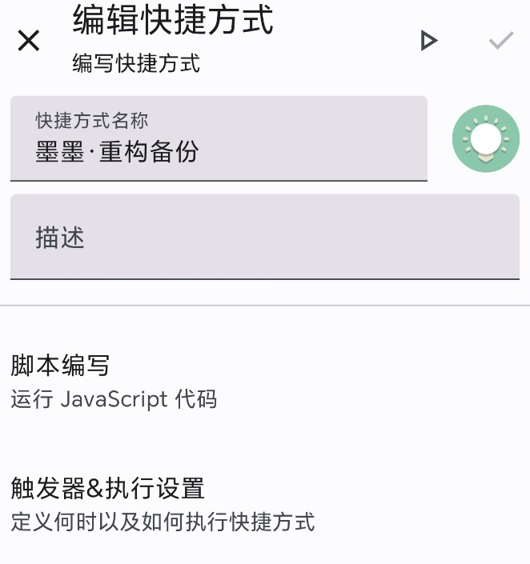
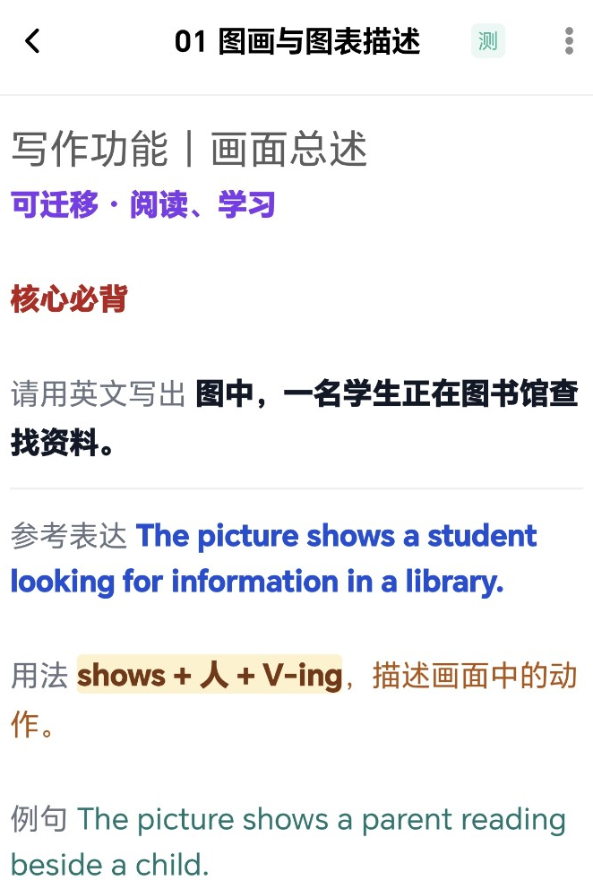

# ENI 英一语料助手｜安卓端完整图文教程

**版本：0.5.0 预览版 · ENI-sync-v2 · GV3**

适用于希望使用 ChatGPT（或能按提示词生成 JSON 的其他 AI）积累考研英语一作文表达，并通过手机同步到墨墨记忆卡的用户。



> **一次配置，日常四步：** AI 制卡 → 复制 JSON → 在 HTTP 快捷方式 App 内执行 → 确认写入。Token 不交给 AI。无需购买服务器、不需要电脑常驻。是否有第三方账号、API 配额或订阅限制，以各服务实际规则为准。

## 01｜准备工作

| 准备项 | 用途 |
|---|---|
| Android 手机 | 执行本地快捷方式 |
| 墨墨记忆卡（Markji）账号 | 建立私有语料牌组、进行间隔复习 |
| HTTP Request Shortcuts | 运行 JS、读取剪贴板、调用墨墨接口 |
| ChatGPT 或其他 AI | 生成标准语料数据 |
| 本仓库文件 | 同步脚本、测试 JSON、可选插件及备份工具 |

软件下载：[Google Play](https://play.google.com/store/apps/details?id=ch.rmy.android.http_shortcuts) / [HTTP Shortcuts GitHub](https://github.com/Waboodoo/HTTP-Shortcuts) / [F-Droid](https://f-droid.org/en/packages/ch.rmy.android.http_shortcuts/)。墨墨网页端：[markji.com](https://markji.com/)。

使用官方来源安装，尽量更新到支持脚本快捷方式、剪贴板和全局变量的版本。下面截图来自开发者个人版真实手机，已裁去状态栏、个人标识等；公开版按钮名称可能因 App 版本或语言不同而略有变化。

## 02｜建立一个私有英语牌组

在墨墨记忆卡的创作/牌组编辑页面创建自己的私有牌组，名称精确设置为：

```text
考研英语一·作文语料
```

将默认空章节改名为第一章，再创建其余七章。以下名称中的序号、空格和汉字都要一致。只保留这八个章节，不要额外保留空默认章节，也不要创建同名私有英语牌组。

| 章节 | 内容 |
|---|---|
| 01 图画与图表描述 | 画面、趋势、比例、数据比较 |
| 02 开篇与主旨提炼 | 主题、寓意、观点 |
| 03 因果与机制论证 | 原因、作用、影响 |
| 04 对比与多角度论证 | 让步、对比、举例、类比 |
| 05 结尾与行动建议 | 总结、措施、呼吁 |
| 06 通用主题语料 | 教育、科技、文化、健康等搭配 |
| 07 小作文功能句 | 邀请、感谢、建议、申请、通知等 |
| 08 个人错题与迁移 | 真实语法、拼写、搭配错误 |

可直接复制 [章节清单](../examples/chapters.txt)。空牌组可以正常使用，不需要先导入任何卡片。公开版脚本动态查询 ID，不用抄写长 ID。

## 03｜获取 Token 并保存在手机

1. 访问 [墨墨开放 API](https://open.maimemo.com/) 按页面说明登录并获取凭证；也可以从墨墨背单词 App 的「我的 → 更多设置 → 实验功能 → 开放 API」进入（以实际界面为准）。
2. 打开 HTTP 快捷方式主界面，右上角 `⋮` → 全局变量（Global Variables）→ `+` → 静态变量。
3. 名称输入 `markji_token`，值粘贴你自己的 API Token，**不要加 `Bearer `**，也不要包含换行或空格。
4. 如果界面提供秘密值、排除导出等保护选项，开启它们；保存。不要导出包含凭证的快捷方式配置。

脚本读取该变量，并仅向墨墨官方域名发送 `Authorization: Bearer <你的 Token>`。Token 不需要提供给 ChatGPT，也不要写进 GitHub Issue、代码、截图或示例 JSON。

### 可选：用普通 GET 请求验证授权

新建普通 HTTP 快捷方式，方法选 GET，请求地址：

```text
https://open.maimemo.com/open/api/v1/markji/decks
```

在认证选项中选择 Bearer Token，或手工设置请求头 `Authorization` 为 `Bearer <你的Token>`（二选一）。仅在本地输入。响应处理选择窗口，运行后若出现 `success: true` 与空 `errors`，说明只读认证通过。不要把完整牌组返回数据公开上传。



> 图：普通 GET 请求设置页。日常同步不要使用普通 GET 类型，下一步需创建「脚本快捷方式」。

## 04｜安装只读自检与同步脚本

### A. 建立「墨墨·配置检查」

打开 [ENI-check.js](../scripts/ENI-check.js) 的 Raw / 原始文本，复制完整代码。

在 HTTP 快捷方式 App 主界面点击 `+`，选择 **脚本快捷方式（Scripting Shortcut）**，名称填 `墨墨·配置检查`，进入「脚本编写」粘贴代码，保存并运行。



> 图：脚本快捷方式界面。截图中的名称是开发阶段的备份工具；本步骤请按实际需要命名。

自检只发 GET 请求，检查认证、唯一私有牌组、八章名称、卡片归属和数量完整性。应返回「配置检查通过」，以及各章节卡片数量。新牌组显示 0 张是正常的。若提示同名牌组或章节不符，回到第 02 步调整。

### B. 建立「墨墨·同步英语语料」

用同样的方法新建脚本快捷方式，名称填 `墨墨·同步英语语料`，但这次粘贴 [ENI-sync.js](../scripts/ENI-sync.js) 的完整原始代码。保存，不需要单独再配请求地址或认证。它会自动复用全局 Token。

**运行位置：** 建议前台打开 HTTP 快捷方式 App，再点列表中的快捷方式。Android 可能限制后台或桌面入口读取剪贴板；不要在桌面直接运行作为首次测试。

### C. 第一次真实写入

1. 打开 [first-card.json](../examples/first-card.json)，使用 Raw / 原始文本复制整个 JSON（从 `{` 到 `}`，不含 Markdown 围栏）。
2. 立即切换到 HTTP 快捷方式 App，点「墨墨·同步英语语料」。不要中途复制别的文字。
3. 核对确认窗口：目标应为唯一英语牌组，章节为 `03 因果与机制论证`，中文提示是「及时的反馈能帮助学习者调整自己的方法。」
4. 点击确定。成功后在墨墨的该章节查看新卡。第一次空库测试应显示新增 1 张、跳过 0 张、现有 1 张。


> 图：个人版真实成功窗口（当时已有 105 张卡片，所以显示 107 张；新用户的数量不同）。

### D. 查重和跨章测试

再次复制同一个 `first-card.json` 运行，应该新增 0 张、跳过 1 张。


然后复制 [three-types.json](../examples/three-types.json) 运行：该文件含上一步的功能句以及一张主题搭配、一张虚构纠错示例。预期跳过 1 张、新增 2 张，分别进入第 06、08 章（前提是从空库按顺序测试）。打开墨墨核对内容与黄色高亮。

**至此即可使用。** 如果不想保留示例卡，可以在墨墨内自己删除示例，但脚本本身没有删除功能。

## 05｜让 AI 生成你的语料卡

### 路线 A：普通提示词（推荐，所有用户可先尝试）

复制 [prompt.md](../examples/prompt.md) 的内容发给 ChatGPT，作为英语训练对话的开场规则。之后上传你自己有权使用的作文、范文或笔记，发送「收录本篇作文中最有价值的 3 条语料」。AI 会给出预览和 `ENI-sync-v2` JSON。

### 路线 B：安装自己的私有技能插件（可选）

本仓库 [plugin/](../plugin/) 包含清理过个人信息的完整技能源码。它只是一个指导 AI 输出标准数据的 Skill，不含账号连接工具、MCP 服务或 API 密钥。

- 如果你的账号有 Plugin Creator：在 ChatGPT 插件目录找到并安装它，把发布页中的独立插件 ZIP（或将 `plugin/` 目录内容打包成 ZIP）交给 Plugin Creator，请它基于源码创建自己的私有插件；若只能按说明创建技能，则提供 `plugin/skills/card-workflow/SKILL.md`。按界面提示完成创建/安装，不要请求 AI 保存墨墨 Token。
- 若管理员/工作空间提供上传插件 ZIP 入口，可以按 [OpenAI 官方插件说明](https://help.openai.com/en/articles/20001256-plugins-in-chatgpt) 上传独立 ZIP。并非每个账号都有该入口；若不可用，直接采用路线 A，不影响同步功能。
- 在英语对话里通过 `@` 选中自己安装的语料助手，再提出收录请求。请注意，开源发布仓库不等于公开上架 ChatGPT 插件目录；本项目不保证插件在每个账号可安装。

### 日常指令

| 需求 | 示例 |
|---|---|
| 单条语料 | 收录这句，并给我墨墨同步数据。 |
| 精读范文 | 收录本篇最有价值的 3～5 条语料，优先跨主题复用。 |
| 作文纠错 | 将我这篇作文中真实出现的语法错误制成复测卡。 |
| 整理图表 | 从上述内容提取图表描述句，按统一八章分类。 |

每次最多 5 张。若要更多，让 AI 分批生成。复制单独 JSON，按第 04 步同步。建议每次完成后看成功提示，而不是把 AI 生成的预览当成已入库。

## 06｜卡片排版与记忆方法



> 图：实测的黄色荧光笔卡片。标题说明写作功能，紫色显示迁移主题；中文在正面，蓝色完整英文、黄色用法和绿色例句在答案面。

| 元素 | 设计意图 |
|---|---|
| 具体功能标题 | 先知道这句话解决什么写作任务 |
| 紫色迁移主题 | 提醒可复用的情境 |
| 红色核心必背 | 指明优先级 |
| 中文粗体提示 | 主动回忆，不提前泄露答案 |
| 蓝色完整英文 | 准确默写目标表达 |
| 黄色高亮用法 | 把关键语法和搭配从解释中提取出来 |
| 绿色迁移例句 | 训练跨题材复用 |

建议先独立写出英文，再查看答案；只背有价值的表达，不盲目收集。每日约 20 分钟复习，并尝试在下一篇作文中复用。

### 数据协议（供想自定义模板的使用者）

```json
{"format":"ENI-sync-v2","cards":[{"deck":"考研英语一·作文语料","chapter":"06 通用主题语料","content":"[P#H1#主题搭配｜培养责任意识]\n[T#B,!7c3aed#可迁移 · 成长、公益]\n\n[T#B,!b91c1c#核心必背]\n\n[T#!6b7280#请默写该搭配] [T#B,!111827#培养责任感]\n---\n[T#!6b7280#高频搭配] [T#B,!1d4ed8#develop a sense of responsibility]\n\n[T#!6b7280#用法] [T#B,!78350f,!!fff2cc#develop a sense of + 抽象名词]\n\n[T#!6b7280#例句] [T#!0f766e#Volunteer work can help students develop a sense of responsibility.]"}]}
```

正反面由单独一行 `---` 分隔。三种答案标签必须保持 `参考表达`、`高频搭配`、`迁移答案` 之一，并使用固定蓝色完整答案标记 `[T#B,!1d4ed8#英文答案]`。黄色高亮在用法区域采用 `[T#B,!78350f,!!fff2cc#内容]`。不要在答案内部插入其他富文本标记，否则精确查重可能无法识别。每卡不超过 5000 字符。

## 07｜可选：备份、旧标准卡美化

新用户**不需要**本节来完成首次配置。若已有标准 ENI V0.3 纯文本卡，想原地升级至荧光笔排版，可选择美化。任意第三方卡片、媒体卡、其他牌组的迁移不在公共版支持范围。

### 本地备份

在 HTTP 快捷方式主界面 `⋮` → 已挂载目录（Mounted Directories）添加手机文件夹，挂载名称必须为 `ENI`。根据 Android 文件选择器完成授权。建立脚本快捷方式「墨墨·备份」，粘贴 [ENI-backup.js](../scripts/ENI-backup.js) 并运行。

脚本只向墨墨查询，直接将完整 JSON 写到挂载目录并回读校验；不会显示大段 JSON 或要求复制大文件。备份中含私人卡片、账号与牌组标识，请留在自己设备，不要上传 GitHub。

### 先只读预览，再选择是否原地美化（写入默认关闭）

建立独立脚本快捷方式「墨墨·全库美化」，粘贴 [ENI-beautify.js](../scripts/ENI-beautify.js)。它仅支持同一牌组中符合旧 ENI 标准格式、GV3 的纯文本卡；遇到未知格式时停止，不强行改动。

**默认是只读预览。** 脚本顶部的 `PREVIEW_ONLY = true` 不要改动时，运行只会显示本批卡片的 ID、所属章节、修改前内容和修改后内容；不会调用墨墨写入接口，也不会创建或修改远端卡片。

1. 首次运行保持 `PREVIEW_ONLY = true`，查看「美化预览」窗口，确认目标卡片和排版变化。预览内容过长时会截断显示，但不会影响原卡。
2. 如果决定实际更新，先按上一节建立本地备份，并确认备份文件成功回读；确保 HTTP 快捷方式已挂载名为 `ENI` 的手机文件夹。
3. 打开脚本，将顶部 `PREVIEW_ONLY = true` 手动改成 `false`，保持 `BATCH_LIMIT=1` 不变。重新运行时仍会先显示预览，然后弹出独立确认框；只有再次确认才会备份本批并调用更新接口。
4. 更新后检查墨墨中的正反面、完整答案、高亮效果和章节。需要处理下一张时再次运行；每次只处理一张，不要并行。
5. 再次运行会自动跳过已经符合新版样式的卡片。

美化通过 POST 更新现有卡，不删除、不重建；脚本检查卡片标识保持不变，但不额外承诺所有第三方客户端的学习记录行为。此工具没有自动恢复功能；遇到异常请停止并保留备份，以手动编辑或经过核验的恢复方案处理。

## 08｜常见问题

| 现象 | 处理方法 |
|---|---|
| `请先复制新版 ENI-sync-v2 JSON` | 复制的是脚本或正文；重新复制 JSON 原文，在 App 主界面运行，不从桌面运行。 |
| 401 / 403 | 检查本地 Token 是否有效、是否误加 Bearer 或包含空格，检查账号权限。 |
| 404 | 核对官方接口、网络及 App 版本；不要修改为来源不明的 API。 |
| 429 / 频控 | 停止操作，稍后再试；不要并发运行或反复重试。 |
| 牌组未找到 / 同名牌组 | 必须恰好一个自建、私有、正常且名称完全一致的目标牌组。 |
| 章节不符 | 检查序号、空格、名称和默认空章节，共 8 章。 |
| 全部重复 | 正常；已有同样的标准英文答案，不会重复新增。 |
| 卡片格式错误 | 检查 format、deck、chapter、独立答案线和固定蓝色答案标签。 |
| 网络失败 / 回读未确认 | 写入可能已发生；先在墨墨检查真实结果，再决定是否重试。 |
| 复制大 JSON 闪退 | 日常每批最多 5 张；全库备份使用挂载目录写文件，不复制响应。 |
| 黄色高亮未显示 | 核对 GV3、标记语法、客户端版本；先验证一张样卡。 |
| 不支持插件安装 | 用 prompt.md 方案；手机端同步不依赖插件权限。 |

不要在错误截图中暴露 Token、完整牌组 ID 或私人语料。

## 09｜技术说明与项目边界

请求地址固定在墨墨官方域名。查询牌组和章节使用 GET；创建卡片使用 `POST /decks/{deck}/chapters/{chapter}/cards`，美化使用 `POST /decks/{deck}/cards/{card}`，路径均相对于 `https://open.maimemo.com/open/api/v1/markji`。创建与更新均传 `card.content` 和整数 `grammar_version: 3`。脚本禁用重定向，校验目标归属、成功响应以及回读数据。单次脚本内部请求间隔约 2.1 秒；用户不要并发或快速反复执行。官方频控可能更新，请查 [墨墨开放 API](https://open.maimemo.com/)。

同步只识别标准答案行，归一化大小写和非字母数字符号后进行匹配；可能将某些不同标点表达视为相同，不做语义去重。未知格式的卡不参与答案查重，若存在会提示。同步不删除和覆盖。可选美化仅更新既有标准卡片的正文。公开版不包含你的私人牌组或个人错题，不提供全库合并或自动恢复。原私人版在 Android 真机上通过新增、重复检测、跨章、样卡高亮及更新；公开版的动态查找和空库场景由离线模拟验证，仍需新用户按教程实测。

## 10｜资料与致谢

- [墨墨开放 API 和制卡指南](https://open.maimemo.com/)
- [HTTP 快捷方式脚本文档](https://http-shortcuts.rmy.ch/scripting) · [全局变量说明](https://http-shortcuts.rmy.ch/variables)
- [HTTP Shortcuts GitHub](https://github.com/Waboodoo/HTTP-Shortcuts)
- [ChatGPT 插件官方说明](https://help.openai.com/en/articles/20001256-plugins-in-chatgpt)
- [项目安全说明](../SECURITY.md)

非官方项目，第三方服务规则与权限以官方文档为准。请勿公开上传真实 API Token、个人备份或无权公开的真题资料/范文。
